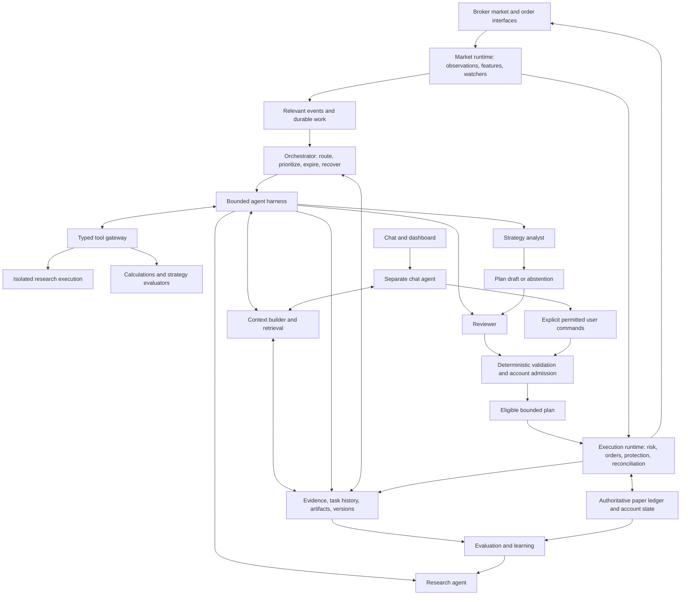

# SWAN rough agentic architecture

Working draft, 22 November 2026, Asia/Kolkata. This captures our current direction for review. Proposed components are not claims of implementation or authorization to activate trading.

## Product and design intent

A personal, single-user trading desk focused initially on intraday NIFTY/SENSEX long-options paper trading. Frontier-model agents use quantitative tools to assess predefined strategies, develop alternatives, and explain decisions. Code continuously observes markets and manages permitted execution. Chat is the main user interface, with a detailed dashboard on demand.

Optimize for net outcomes, defensible evidence, bounded drawdown, and reliable operation. Neither additional agents nor daily activity establishes an edge. Agent-originated strategies are research candidates until evaluated.

Use stable interfaces between durable state, reasoning, and actions. The Anthropic [Managed Agents article](https://www.anthropic.com/research/managed-agents) motivates these boundaries. The architecture below is our proposed adaptation, not a requirement to adopt its hosted service.

## Logical architecture

The broker execution arrow is a future adapter boundary. Current scope is paper execution; real brokerage is not implemented or authorized by this diagram. Chat has no direct order capability. Existing command permissions remain authoritative.

These are logical modules. Avoid creating a service, queue product, or model instance for every box. Market/execution work needs isolation from blocking research, but a single user does not require an institutional distributed platform.

## Responsibility boundaries

| Boundary | Owns | Important distinction |
| --- | --- | --- |
| Trading session | Verified exchange window, mandate, account operating scope | Different from an agent session or chat |
| Agent session | Durable assignment and linked history | Outlives one process and one context window |
| Run | An attempt to carry out an assignment | Restart/retry does not renew an opportunity |
| Orchestrator | Scheduling, dependencies, priority, task ownership, deadlines, cancellation | Code, not another manager LLM |
| Harness | Model/tool loop, context assembly, capability checks, output validation, budgets | Runs one assignment without owning global execution authority |
| Context builder | Task-relevant observations, changes, retrieved artifacts, unknowns | A temporary view of records, not their authoritative replacement |
| Tools | Typed reads, calculations, assessments, experiments | Return provenance and errors; do not enlarge permissions |
| Research sandbox | Isolated generated experiments | No broker secrets, self-deployment, or implicit production access |
| Market runtime | Ingestion, normalization, incremental features, trigger detection | Continuous code work without continuous model inference |
| Execution runtime | Current risk checks, order lifecycle, exits, reconciliation, request budgeting | Protection does not depend on agent availability |
| Evaluation | Correctness, agent quality, operational behavior, economic results | Reviewer approval is not evaluation evidence |

The paper ledger remains authoritative for balances, positions, and fills. Agent logs explain decisions but are not an alternate accounting system. Keep market history, task events, and ledger records distinct and linked. Do not put every raw tick into an agent session log.

## Initial agent roles

Recommend four roles, three for autonomous reasoning and one for conversation:

1. Strategy analyst: assess conditions, compare predefined strategies, select or abstain, and draft bounded plans.
2. Research agent: investigate gaps, develop strategies and calculation tools, and analyze session outcomes.
3. Reviewer: challenge the plan's evidence, assumptions, strategy fit, and contradictions.
4. Chat agent: explain recorded activity and invoke only explicitly permitted user commands.

Roles may share a model/provider while using separate instructions, tools, contexts, and budgets. They are not four permanently running conversations. Market assessment and option-selection reasoning initially belong to the analyst. Post-session learning belongs to research. Portfolio/risk calculations are tools and deterministic controls.

The existing analysis/proposal/review stages can map into these roles without a wholesale replacement. A second review call can share the first model's blind spots; record and evaluate its marginal value. Additional models are a possible experiment, not proof of independence.

Add a specialist only when it has a distinct measurable responsibility, useful parallelism, necessary context separation, or different capabilities. Possible later specializations include options construction, event research, and experiment evaluation. Do not add a model agent for pricing arithmetic, risk limits, scheduling, order monitoring, or broker throttling.

## Design patterns

- Event-driven work: watchers emit meaningful changes rather than waking models per tick.
- Explicit workflows for known strategies: deterministic assessments feed a bounded analysis/review process.
- Bounded agent loops for research: tool choices are flexible within time, spend, and capability limits.
- Shared artifacts with ownership: agents exchange versioned records instead of relying on an unstructured group conversation.
- Typed tool interfaces and capability boundaries: narrow operations with provenance and explicit failure states.
- Durable tasks with leases and stale-worker fencing: recovery cannot let an obsolete run overwrite newer work.
- Atomic event/work publication where needed: do not commit a decision and silently lose the task it should trigger.
- Idempotent requests and external reconciliation: retries do not imply exactly-once broker effects.
- Immutable evidence and derived views: retain sources needed to explain an assessment without treating all tables as event-sourced.
- Research isolation and version promotion: proposed code or strategies cannot replace active definitions by themselves.

Suggested task states include queued, running, waiting for a dependency, completed, failed, cancelled, expired, and superseded. Final domain outcomes such as abstention remain explicit artifacts, not generic failures. Persist enough state to reconstruct a run while recognizing that replaying a model call need not reproduce identical reasoning.

## Trigger and compute policy

Observe continuously using code. On relevant bar completion, level proximity, strategy eligibility transition, material context change, or session boundary, evaluate whether a model job adds value. Use cooldowns, deduplication, and hysteresis without changing a strategy's defined trigger semantics.

Prepare plans before execution triggers when possible. At trigger time, code validates the current plan, evidence, account state, and execution feasibility. New judgment that finishes too late is discarded. Stops, targets, time limits, feed problems, and reconciliation are immediate service responsibilities.

Separate three budgets: market-data subscriptions/read calls, model/tool computation, and order requests. One budget cannot be inferred from another. Broker placement, modification, cancellation, and exits share account-level capacity; preserve protection headroom, bound repricing, reconcile timeouts, and expire queued entries. Refer to the dated broker-limit findings in [the intelligence handoff](./STRATEGY-INTELLIGENCE-HANDOFF.md), and verify effective limits before eventual live integration.

## Tools and code that make sense

Start with roughly a dozen coherent agent-facing operations, backed by whatever internal functions are appropriate. This is a planning estimate, not a fixed API count. Expose only tools useful for the assigned task.

| Tool family | Initial operations or outputs |
| --- | --- |
| Evidence retrieval | Bounded market snapshot; attributed relevant information; exact evidence lookup |
| Strategy knowledge | Read strategy cards and versions; assess predefined eligibility |
| Quantitative analysis | Feature calculations and declared options sensitivities/scenarios |
| Candidate construction | Compare actual eligible contracts with spread, liquidity, expiry, and cost constraints |
| Account context | Reconciled exposure and available risk capacity |
| Trade economics | Sizing and cost scenarios using deterministic policy; unknown estimates stay unknown |
| Research | Bounded experiment execution; save a versioned hypothesis or candidate tool |
| Historical retrieval | Previous decisions, results, and evidence-linked findings |

This could initially be 10-15 callable operations. Avoid one tool per indicator or one opaque tool that claims to do all analysis. Calculation tool granularity should follow composability, context size, and verifiability. Missing inputs return unavailable results, not substitutes invented by a model.

Infrastructure code separately provides durable storage, event scheduling, context building, identity/permissions, budgets, order state machines, accounting, and telemetry. Those do not all need model-facing tool endpoints.

## Evaluation and memory

Measure software correctness, agent decision quality, operational reliability, and trading economics separately. Link evidence, strategy/prompt/tool versions, proposals, reviews, validation, orders, and fills. Compare deterministic baselines against agent-assisted decisions under matched assumptions.

Short-lived context contains current task evidence and recent changes. Durable history retains original records. Long-lived learning contains evidence-linked hypotheses and evaluated procedures, with scope and version. Summaries aid retrieval; they do not replace originals or become trading rules automatically.

Agent-written conclusions are hypotheses until supported. Numerical promotion thresholds, acceptable drawdown, and observation duration remain open. No reviewer or LLM judge can alone declare a strategy profitable.

## Separate explanation: human and agentic trading workflow

Both workflows solve the same sequence of problems. Automation changes who does the reasoning and how consistently actions are recorded.

| Stage | Human workflow | Proposed SWAN workflow |
| --- | --- | --- |
| Prepare | Check session, funds, positions, events, and personal limits | Services establish verified session/account state; analyst prepares relevant context |
| Find a setup | Watch charts and compare price behavior with familiar patterns | Watchers calculate features and predefined eligibility; analyst is invoked for relevant decisions |
| Form a hypothesis | State direction, catalyst, expected move, and what would prove it wrong | Analyst creates an evidence-linked plan or abstains |
| Choose the option | Compare expiry, strike, premium, liquidity, and sensitivity | Tools compare actual contracts; analyst applies an allowed selection policy |
| Size and plan exits | Choose quantity, invalidation, stop, target, and time limit | Tools calculate whole-lot capacity and scenarios; deterministic policy limits the plan |
| Place an order | Submit a specific contract, side, quantity, type, and price | One execution owner submits an admitted intent through the relevant paper/future broker adapter |
| Observe execution | Check rejection, working order, partial fill, or fill | Order events and reconciliation update authoritative state; an acknowledgement is not a fill |
| Manage exposure | Monitor changes and execute exits | Independent code monitors actual exposure and existing protective rules |
| Close | Sell the owned long-option quantity and confirm the outcome | Exit intent, fills, fees, and remaining quantity reconcile; unresolved outcomes remain pending |
| Review | Journal decisions, results, and mistakes | Compute results; research proposes evidence-linked changes for later evaluation |

An index breakout is a setup, not an option purchase. A call purchase expresses an upward view, but its premium is also affected by volatility, time, and changing sensitivity. Expiry payoff and a planned intraday exit are different analyses. Reference: [Zerodha options Greeks](https://zerodha.com/varsity/chapter/the-option-greeks-delta-part-1/).

For long-option positions, gross realized P&L is the sum of exit sale proceeds minus the entry cost allocated to those closed units. Net trading P&L also deducts applicable charges. Keep open-position marks, realized results, and software/model costs separately visible. Premium quotes are per unit; actual order quantities must follow current contract metadata and lot rules.

An underlying invalidation boundary is not an option-premium stop. Reaching a signal level does not guarantee liquidity, execution price, or a bounded loss. A pending entry is not a position. A cancellation request is not proof that no fill happened. Paper and broker adapters can share intent/state concepts but must preserve their different execution evidence.

## Current foundations and open choices

The inspected code has a bounded analysis/proposal/review pipeline, provider budget and audit handling, durable worker slots, paper accounting, risk controls, and an isolated ORB evaluator. It does not yet establish the complete architecture described here. The implementation plan identifies the underlying-bar evidence gap and staged integration path. RESUME.md was absent during this architecture review; do not recreate it from old conversation context.

Framework choice is open. LangGraph is a candidate for explicit persisted agent control flow; Temporal is a candidate if durable cross-job orchestration warrants its operational cost. Do not assign both overlapping ownership of retries and state. The architecture should remain understandable without either name.

Next choices to solidify: task/artifact contracts, process and recovery boundaries, agent capability matrix, context retrieval policy, tool interfaces, and the path from reviewed plan to deterministic admission. Detailed human intervention, new chat permissions, and eventual real-money execution require separate decisions.

No running-task scope is expanded by this draft. Do not overwrite the implementation chat's plan or duplicate its current work. Existing stopped-worker/disabled-entry and deferred broker/live-acceptance boundaries persist. This turn creates only this architecture document and does not update DEFERRED-WORK.md.
